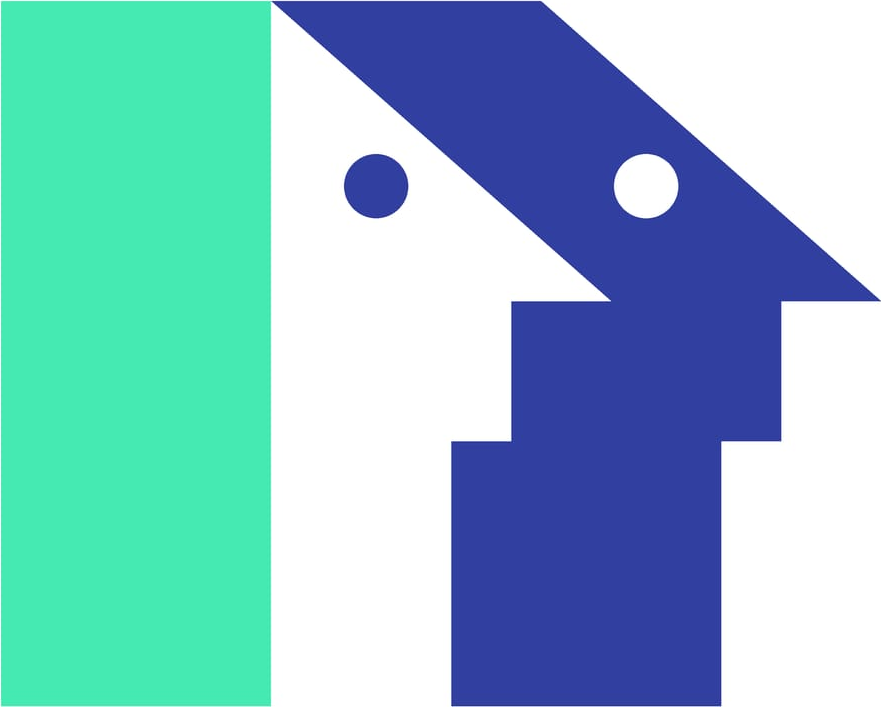

<p align="center">
  
</p>

<h1 align="center">Persona CLI</h1>
<p align="center"><strong>People for your next prototype.</strong><br>Coherent fictional profiles, contextual portraits, JSON fixtures and seed templates.</p>

<p align="center">
  <a href="https://www.npmjs.com/package/@osiris_balonga/persona-cli"></a>
  
  <a href="https://github.com/Osiris-Balonga/persona/blob/dev/LICENSE"></a>
</p>

<p align="center">
  <a href="https://github.com/Osiris-Balonga/persona/blob/dev/api/docs/developer-api.md">Quickstart</a> ·
  <a href="https://github.com/Osiris-Balonga/persona/blob/dev/api/docs/api.md">API reference</a> ·
  <a href="https://github.com/Osiris-Balonga/persona/issues">Issues</a>
</p>

```sh
npm install --save-dev @osiris_balonga/persona-cli
npx persona people --count 20 --nationality CG --output fixtures/people.json
```

Build a directory, populate a dashboard, prototype an onboarding flow or prepare a database seeder. Persona gives you structured names, locations, ages and contact details, with reviewed synthetic portraits when a matching image is available. No account or API key is needed.

## A face for the context

Everyday profiles, medical teams, construction crews, business directories and school demos can use different portrait collections.

| Everyday | Healthcare | Construction | Business | School |
| :---: | :---: | :---: | :---: | :---: |
|  |  |  |  |  |
| `standard` | `doctor` | `construction` | `business` | `school-pupil` |

These are approved synthetic portraits from Persona's versioned public catalog. They illustrate the collections; an individual request may select another portrait or return `picture: null`. A portrait context controls eligible ages and imagery, not a person's occupation or qualifications.

```sh
# A medical directory
npx persona people --count 12 --portrait-context doctor --age-group adult

# A construction crew
npx persona people --count 12 --portrait-context construction --age-group adult

# A school demo
npx persona people --count 12 --portrait-context school-pupil --age-group child
```

The CLI also accepts `business`, `standard` and `university-student`. Context support and portrait availability depend on the API deployment. `university-student` is accepted but has no released portrait collection. Omit `--portrait-context` to use the API's default selection. An incompatible context/age combination returns an error; missing imagery returns `picture: null`.

## What you get

- **Coherent profiles:** nationality, residence, city and age filters work together.
- **Structured JSON:** names, dates of birth, illustrative addresses, contacts and image URLs.
- **Repeatable fixtures:** pin a seed and reference date for tests and demos.
- **Larger collections:** export up to 10,000 people through bounded API pages.
- **Useful seed templates:** start a Prisma or generic seeder that you adapt to your application.
- **Script-friendly output:** JSON on stdout, messages on stderr, exit code 0 on success and 1 on failure.

## Install

Requires **Node.js 24**. Install in your project:

```sh
npm install --save-dev @osiris_balonga/persona-cli
npx persona --help
npx persona --version
```

Or install globally:

```sh
npm install --global @osiris_balonga/persona-cli
persona --help
```

The CLI calls the public Persona HTTP API. The CLI built from this source defaults to the public `https://persona.osirisbalonga.me/api` entry after the migration release. Previously published versions may still default to Render staging; use an explicit `--api-url` to select the intended deployment. New pagination or portrait features require a compatible server. Override it with `--api-url` or `PERSONA_API_URL`; the explicit flag takes precedence:

```sh
npx persona people --api-url http://localhost:3000 --count 3
```

Supply the public `/api` entry or a legacy API base URL without `/people`. HTTP(S) URLs cannot include credentials, query strings or fragments. Redirects are rejected. The CLI does not generate profiles offline.

## Start with your use case

### Create a fixture file

```sh
npx persona people --count 20 --nationality CG --age-group adult \
  --seed dashboard-demo --as-of 2026-11-12 --output fixtures/people.json
```

Parent directories are created automatically. Existing files are preserved unless you add `--force`. File exports stream to a temporary sibling and publish the final file only after every page succeeds; a failed export preserves the original even with `--force`.

### Choose the fields you need

```sh
npx persona people --count 3 --fields name,email,picture.thumbnail
```

Responses contain a `results` array and replay `meta`. A projected person has this shape (illustrative values):

```json
{
  "name": { "first": "Marie", "last": "Martin", "full": "Marie Martin" },
  "email": "m.martin.abc00@example.test",
  "picture": null
}
```

Without projection, profiles also include `id`, `gender`, `nationality`, `dob`, `location` and `phone`. A matching `picture` contains `large`, `medium` and `thumbnail` WebP URLs. `login` is opt-in through `--fields`. See the [complete JSON example](https://github.com/Osiris-Balonga/persona/blob/dev/api/examples/people-response-v2.json).

### Separate nationality from residence

```sh
npx persona people --nationality FR --residence-country CG --city Brazzaville
```

Nationality selects the reviewed name pool; residence selects the city and phone numbering country. `--continent` restricts nationality. A recognized country code does not guarantee an available name pool; inspect coverage before choosing your filters.

### Export more than 100 people

```sh
npx persona people --count 1000 --limit 100 --seed bulk-demo \
  --as-of 2026-11-12 --output fixtures/people.json
```

`--count` is the total; `--limit` is the maximum page size. The CLI follows API cursors automatically, preserving seed, reference date, order and generation metadata. The final envelope contains all people, `meta.count` equal to the total and no per-page `meta.pagination`.

Every page consumes an API request. Paginated 429 responses get at most three retries per page, respecting integer `Retry-After` delays of 0–120 seconds. Other errors stop the export. Legacy single requests without pagination are not retried. Requests time out after 30 seconds, and each response is capped at 256 KiB. Missing pages, repeated cursors or changing generation metadata fail the command. Stdout is emitted only after the full collection succeeds.

### Inspect country coverage

```sh
npx persona countries --available
npx persona countries --country CG
npx persona countries --json
```

Coverage is a bundled snapshot tied to the CLI's data version, rather than a live server query. It reports profile readiness, sampled cities, postcode coverage and phone sources. Country data may differ from another API deployment. The [country availability table](https://github.com/Osiris-Balonga/persona/blob/dev/api/docs/country-availability.md) explains the statuses.

## From fixtures to a database seeder

```sh
npx persona seed init --adapter prisma
# Or use your own database client:
npx persona seed init --adapter generic
```

Prisma creates `prisma/seed.ts`; generic creates `scripts/seed.ts`. Templates read `fixtures/people.json` relative to the generated seed file. Use `--output <file>` to choose another location. Existing seed files are never overwritten.

The template deliberately stops until you adapt `mapPerson` and implement `insertPeople`. It does not inspect a database, change schema/configuration, install an ORM or perform inserts. Generate full fixtures without `--fields`, or adapt the reader to your projection.

For an existing Prisma project, reuse its configured client, choose the appropriate adapter and register the seed command for your installed Prisma version. Read the [Prisma seeding guide](https://www.prisma.io/docs/orm/prisma-migrate/workflows/seeding). Execute the seeder only after reviewing its mapping, insertion logic and target database.

## Command reference

| Command | Purpose |
| --- | --- |
| `persona people` | Generate JSON profiles or export a fixture file |
| `persona countries` | Inspect bundled coverage; supports `--country`, `--available`, `--json` |
| `persona seed init` | Create a template with `--adapter prisma` or `--adapter generic` |
| `persona --help` | Show help and the terminal brand mark |
| `persona --version` | Print the installed version |

| `people` option | Meaning |
| --- | --- |
| `--count <1-10000>` | Total profiles; default 1 |
| `--limit <1-100>` | Maximum page size; default 100; explicitly enables pagination |
| `--gender <male\|female>` | Gender filter |
| `--age-group <groups>` | `child`, `teen`, `adult`, `senior`; comma-separated |
| `--portrait-context <context>` | One supported portrait context |
| `--nationality <code>` | Reviewed uppercase two-letter nationality |
| `--residence-country <code>` | Residence country |
| `--continent <name>` | `africa`, `americas`, `asia`, `europe`, `oceania` |
| `--city <name>` | City in the selected residence country |
| `--email-domain <domain>` | Generated email domain; default `example.test` |
| `--seed <value>` | Replay seed |
| `--as-of <YYYY-MM-DD>` | Reference date; default current UTC date |
| `--fields <paths>` | Comma-separated public field paths |
| `--output <file>` | Export the complete envelope |
| `--force` | Replace an existing output after successful generation |
| `--api-url <base-url>` | Override `PERSONA_API_URL` and the default API |

Unknown or repeated options are rejected. Use `persona <command> --help` for command help. `--no-color` and `NO_COLOR` disable terminal colors; redirected output has no ANSI escapes.

## Replay and data use

Keep both `--seed` and `--as-of`, the applied filters and returned version metadata. Reproducibility depends on unchanged data, portrait catalog and generation algorithms. New server versions can invalidate cursors; start a fresh export instead of combining versions.

Profiles and portraits are synthetic. Addresses are illustrative, coordinates identify a city rather than a person, and some format-valid phone numbers may belong to real subscribers. Never contact generated email addresses or phone numbers. Finite name and portrait pools can repeat; a larger collection does not guarantee unique names or pictures.

## Development and contributing

```sh
git clone https://github.com/Osiris-Balonga/persona.git
cd persona
npm ci
npm run build:cli
npm run check:cli-package
npm run cli -- --help
```

The package check installs an archive in a temporary application and verifies its executable, country data and seed resources. Contributor workflow, test suites and release steps live in [CONTRIBUTING.md](https://github.com/Osiris-Balonga/persona/blob/dev/CONTRIBUTING.md) and the [CLI release guide](https://github.com/Osiris-Balonga/persona/blob/dev/api/docs/cli-release.md).

The terminal brand mark is bundled; no image renderer or image library is required at runtime. Maintainers can regenerate it with `node scripts/generate-cli-logo.mjs` using Chafa. Source artwork is excluded from the npm archive. Persona branding belongs to the project owner; the gallery uses the approved synthetic portrait catalog.

## License

[MIT](https://github.com/Osiris-Balonga/persona/blob/dev/LICENSE).
